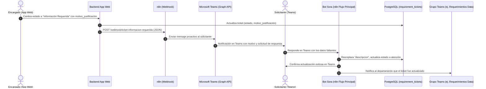

# Especificación Técnica: Webhook de Información Requerida para Sora (Teams)

Este documento contiene todo el contexto, especificación técnica, modelos de datos y ejemplos de integración necesarios para implementar el Webhook en la aplicación web de gestión de requerimientos.

---

## 1. Contexto y Objetivo

Cuando un encargado revisa un ticket desde la aplicación web y detecta que hace falta información para continuar, cambia el estado del ticket a **`Información Requerida`** y redacta un comentario obligatorio en el campo **`motivo_justificación`**.

El objetivo de esta integración es que, en el instante en que el encargado guarda este cambio en el aplicativo web:
1. El aplicativo dispare un **HTTP POST (Webhook)** hacia n8n.
2. n8n localice al solicitante en Microsoft Teams y le envíe una **tarjeta proactiva** con el motivo detallado de la información requerida.
3. El solicitante pueda responder directamente en el chat de **Sora** en Teams.
4. **Sora** procese la respuesta, actualice automáticamente la `descripcion` del ticket en la base de datos PostgreSQL, cambie el estado del ticket y alerte al grupo del departamento correspondiente (ej. **Requerimientos Data**).

---

## 2. Diagrama de Secuencia del Flujo



---

## 3. Especificación del Webhook (App Web -> n8n)

### Configuración del Endpoint
- **Método HTTP:** `POST`
- **URL sugerida en n8n:**  
  - *Producción:* `https://n8n.gif-amp.com/webhook/ticket-informacion-requerida`
  - *Pruebas (Test):* `https://n8n.gif-amp.com/webhook-test/ticket-informacion-requerida`
- **Headers requeridos:**
  ```http
  Content-Type: application/json
  ```
- **Autenticación (Opcional recomendada):**  
  Header personalizado: `X-Webhook-Token: <TOKEN_SECRETO>` o `Authorization: Bearer <TOKEN>`

---

### Payload JSON (Cuerpo de la Petición)

El aplicativo debe enviar un JSON con los siguientes campos:

```json
{
  "event": "ticket_information_required",
  "ticket_id": "4203e77b-d455-4179-86b9-824b91ae9ac8",
  "asunto": "Falla en carga de ventas de restaurante",
  "creator_email": "sarazo@ifsagroup.com",
  "nombre_solicitante": "Sebastián Arazo",
  "departamento_destino": "DATA",
  "tipo_solicitud": "Troubleshooting",
  "motivo_justificacion": "Por favor indícanos a qué fecha y turno específico corresponde el lote faltante.",
  "encargado": "Benjamin Zurita",
  "empresa": "Arturos",
  "departamento": "Restaurante Chacao"
}
```

### Diccionario de Campos

| Campo | Tipo | Obligatorio | Descripción |
| :--- | :--- | :---: | :--- |
| `ticket_id` | `UUID` (string) | **Sí** | Identificador único del ticket en `public.requirement_tickets`. |
| `creator_email` | `string` | **Sí** | Correo corporativo del solicitante (usado para encontrar el usuario en Teams/Graph). |
| `motivo_justificacion` | `string` | **Sí** | Comentario detallado ingresado por el encargado explicando qué información falta. |
| `departamento_destino` | `string` | **Sí** | Departamento que atiende el ticket (`DATA`, `TRADE` o `HELPDESK`). |
| `asunto` | `string` | **Sí** | Título o asunto del requerimiento. |
| `encargado` | `string` | No | Nombre o correo del encargado que solicita la información. |
| `nombre_solicitante` | `string` | No | Nombre completo del usuario solicitante. |
| `empresa` | `string` | No | Empresa del solicitante (ej. `Arturos`, `IFSA`). |
| `departamento` | `string` | No | Sede, restaurante o gerencia del solicitante. |
| `tipo_solicitud` | `string` | No | Categoría o tipo de solicitud del ticket. |

---

## 4. Ejemplos de Implementación en Backend

### Opción A: Node.js (Express / TypeScript / Fetch)
```typescript
async function onTicketStatusChange(ticket: Ticket, newStatus: string, motivoJustificacion: string, userSession: User) {
  if (newStatus === 'Información Requerida') {
    const payload = {
      event: 'ticket_information_required',
      ticket_id: ticket.id,
      creator_email: ticket.creator_email,
      nombre_solicitante: ticket.nombre_solicitante,
      asunto: ticket.asunto,
      departamento_destino: ticket.departamento_destino,
      tipo_solicitud: ticket.tipo_solicitud,
      motivo_justificacion: motivoJustificacion,
      encargado: userSession.full_name || userSession.email,
      empresa: ticket.empresa,
      departamento: ticket.departamento
    };

    try {
      await fetch('https://n8n.gif-amp.com/webhook/ticket-informacion-requerida', {
        method: 'POST',
        headers: {
          'Content-Type': 'application/json',
          // 'X-Webhook-Token': process.env.N8N_WEBHOOK_SECRET
        },
        body: JSON.stringify(payload)
      });
      console.log(`[Webhook] Notificación de Info Requerida enviada para el ticket ${ticket.id}`);
    } catch (error) {
      console.error(`[Webhook Error] No se pudo enviar notificación para ticket ${ticket.id}:`, error);
      // No bloquear la transacción de la BD si falla la red del webhook
    }
  }
}
```

### Opción B: Python (FastAPI / Django / requests)
```python
import requests

def notify_information_required(ticket, motivo_justificacion, encargado_name):
    webhook_url = "https://n8n.gif-amp.com/webhook/ticket-informacion-requerida"
    payload = {
        "event": "ticket_information_required",
        "ticket_id": str(ticket.id),
        "creator_email": ticket.creator_email,
        "nombre_solicitante": ticket.nombre_solicitante,
        "asunto": ticket.asunto,
        "departamento_destino": ticket.departamento_destino,
        "tipo_solicitud": ticket.tipo_solicitud,
        "motivo_justificacion": motivo_justificacion,
        "encargado": encargado_name,
        "empresa": ticket.empresa,
        "departamento": ticket.departamento
    }
    try:
        requests.post(webhook_url, json=payload, timeout=5)
    except Exception as e:
        print(f"Error enviando webhook a n8n: {e}")
```

### Opción C: PHP (Laravel)
```php
use Illuminate\Support\Facades\Http;

if ($newStatus === 'Información Requerida') {
    Http::timeout(5)->post('https://n8n.gif-amp.com/webhook/ticket-informacion-requerida', [
        'event' => 'ticket_information_required',
        'ticket_id' => $ticket->id,
        'creator_email' => $ticket->creator_email,
        'nombre_solicitante' => $ticket->nombre_solicitante,
        'asunto' => $ticket->asunto,
        'departamento_destino' => $ticket->departamento_destino,
        'tipo_solicitud' => $ticket->tipo_solicitud,
        'motivo_justificacion' => $motivoJustificacion,
        'encargado' => auth()->user()->name,
        'empresa' => $ticket->empresa,
        'departamento' => $ticket->departamento,
    ]);
}
```

---

## 5. Formato de Mensaje que Recibirá el Solicitante en Teams

Cuando n8n procese el webhook, el usuario recibirá en su Teams un mensaje formateado como el siguiente:

> ⚠️ **Información Requerida para tu Ticket**  
>  
> 🔹 **Ticket ID:** `#4203e77b-d455-4179-86b9-824b91ae9ac8`  
> - **Asunto:** Falla en carga de ventas de restaurante  
> - **Departamento:** DATA  
> - **Encargado:** Benjamin Zurita  
>  
> 💬 **Mensaje del Encargado:**  
> *"Por favor indícanos a qué fecha y turno específico corresponde el lote faltante."*  
>  
> ✍️ *Puedes responder directamente aquí en el chat indicando el número de tu ticket y la información solicitada para actualizarlo.*

---

## 6. Manejo de Errores y Buenas Prácticas

1. **Llamada Asíncrona (Non-blocking):**
   - El disparo del webhook desde el backend de la app web debe ser asíncrono o ejecutarse en segundo plano (job/queue o dentro de un `try/catch` sin bloquear el `UPDATE` en la base de datos). Si n8n demorase en responder, la interfaz web del encargado no debe quedarse congelada.
2. **Validación de Correo:**
   - Asegurarse de que `creator_email` contenga el correo corporativo con el que el usuario inicia sesión en Microsoft Teams (generalmente `@ifsagroup.com` o `@arturos.com.ve`).
3. **Idempotencia:**
   - Si el encargado edita el motivo o reenvía la solicitud de información requerida, el webhook se ejecutará nuevamente notificando al usuario con la última indicación.
